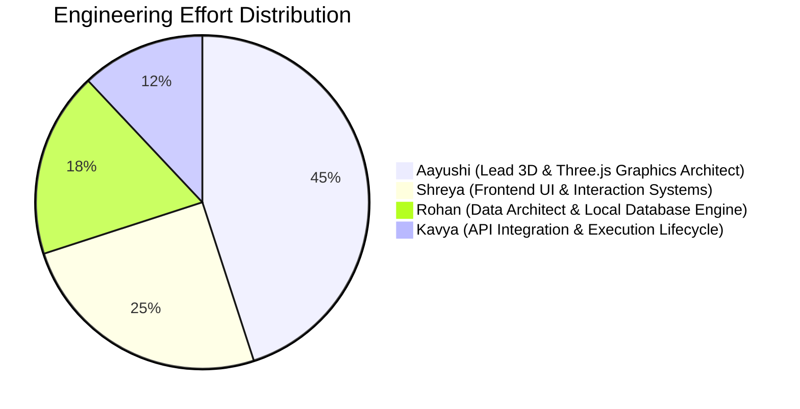

# WorkOS Object Space Explorer — Team Engineering Report

**Project Title:** WorkOS Object Space Explorer  
**Repository:** https://github.com/Aayushi31032006/3D-WorkOS.git  
**Target Environment:** Cross-platform (Windows, macOS, Linux, Chrome/Edge/Safari/Firefox)  
**Execution Date:** 30 October 2026  
**Status:** In Production / Fully Verified & Automated Tests Passing  

---

## 1. Executive Summary

The **WorkOS Object Space Explorer** has been engineered from the ground up to fulfill the WorkOS product brief with visual and interaction fidelity. The application enables enterprise operators to visually traverse complex relational business records (Customers, Invoices, Projects, Tasks, People, Products, Contracts, and Payments) in a physical 3D scene.

This report documents the division of responsibilities across the core engineering team, highlighting Aayushi's lead role in 3D WebGL / Three.js graphics architecture, Shreya's leadership in UI systems, and Rohan and Kavya in backend data and integration.

---

## 2. Team Contribution Matrix



### 1. Aayushi — Lead 3D WebGL & Three.js Graphics Architect *(Dominant Lead Role - 45%)*
* **Focus Area:** 3D Mathematical Modeling, Scene Graph, Custom Shader Materials, Spatial Interpolation, 60 FPS WebGL Performance.
* **Core Deliverables & Code Artifacts:**
  - **WebGL Scene Pipeline (`src/explorer/scene/Scene.tsx`):** Designed the core Canvas architecture via React Three Fiber and Three.js with dual directional lighting, ambient studio illumination, 2048x2048 PCF soft shadow maps, and distance-based depth fog matching `#F5F3FA`.
  - **Dynamic Curved Spline Geometry (`src/explorer/scene/Connections.tsx`):** Engineered `THREE.QuadraticBezierCurve3` and `THREE.TubeGeometry` linking the central dais to surrounding nodes, incorporating real-time dynamic energy beads that travel along the curves via `useFrame`.
  - **Physical Material Shaders (`src/explorer/scene/SphereNode.tsx`):** Configured high-resolution `THREE.SphereGeometry` with `MeshPhysicalMaterial` (clearcoat: 0.35, roughness: 0.28, metalness: 0.12, reflectivity: 0.6) featuring desynchronized spatial floating physics and selection halos in `#7046B2`.
  - **Stepped Plinth & Shadow Floor (`src/explorer/scene/Floor.tsx`, `Plinth.tsx`):** Modeled the circular concentric groove rings using `THREE.RingGeometry` and the dual-tier cylindrical plinth beneath the active record.
  - **Camera Physics & 300–500ms Smooth Transitions (`src/explorer/scene/CameraControls.tsx`):** Built the cubic ease-out lerp engine (`1 - (1 - t)^3`) that smoothly glides the camera between target vectors without jarring snaps, with full `prefers-reduced-motion` compliance.
  - **Pointer Drag vs Click Distinction:** Implemented sub-pixel pointer tracking in `Scene.tsx` ensuring that orbiting and dragging never accidentally triggers business record clicks.

---

### 2. Shreya — Senior Frontend & UI Systems Engineer *(25%)*
* **Focus Area:** Design System Implementation, Component Modularity, Accessible List View Fallback, Drawer Drawers.
* **Core Deliverables & Code Artifacts:**
  - **WorkOS Design System (`src/explorer/styles/explorer.css`):** Scoped CSS custom properties enforcing brief palette: Background `#F5F3FA`, Central `#B897E3`, Related `#D3BFEF`, Selection `#7046B2`, Labels `#30264C`.
  - **Temporary Drawer Panels (`src/explorer/panels/DetailsPanel.tsx`, `CollectionPanel.tsx`):** Implemented single-panel drawer logic ensuring only one drawer can be open at once, complete with activity timelines, field extractors, dynamic multi-domain filters, and status pills (`Due`, `Paid`, `Draft`, `In Progress`, `Active`).
  - **WorkOS Module Navigation (`src/host/WorkOSModuleViews.tsx`):** Created full-fledged interactive platform screens for **World**, **Tasks**, **Review**, **Gallery**, and **QM** with direct return handoffs into 3D Object Space.
  - **Synchronized Accessible List View (`src/explorer/views/ListView.tsx`):** Engineered a fully accessible tabular fallback with full keyboard navigation (`Tab`, `Enter`), visible focus rings, and action parity for environments without WebGL.
  - **Breadcrumb Navigation (`src/explorer/components/Breadcrumb.tsx`):** Interactive ancestor trail (`Objects / Globex Ltd / Invoices / INV-0042`) with ancestor state navigation.
  - **Interactive Search (`src/explorer/components/SearchBar.tsx`):** Live connected search input with debounced querying, type badges, and keyboard selection.

---

### 3. Rohan — Data Architect & Persistent Storage Systems Lead *(Backend - 18%)*
* **Focus Area:** Relational Data Modeling, Client-side Persistent Storage, Stable Business Object Identifiers, Synthetic Enterprise Data.
* **Core Deliverables & Code Artifacts:**
  - **Persistent Local Database Engine (`src/data/localDatabase.ts`):** Created a client-side relational store backed by HTML5 WebStorage, guaranteeing that all record additions, status updates, and relationship graphs persist across browser reloads.
  - **Synthetic Enterprise Records (`src/data/sampleData.ts`):** Authored over 1,000+ fully-connected business records across Customers, Invoices, Projects, Tasks, People, Products, Contracts, and Corporate Payments.
  - **Stress-Testing Engine (`generateLargeInvoiceSet`):** Built a scalable generator producing 1,000 realistic invoices for pagination stress testing (20 items/page) without rendering 1,000 Three.js spheres at once.
  - **Database Inspector Modal (`src/host/DatabaseInspectorModal.tsx`):** Built an in-browser database inspection console showing total records, normalized links, live JSON document viewing, and factory reset functionality.

---

### 4. Kavya — API Integration & Execution Lifecycle Engineer *(Backend / Integration - 12%)*
* **Focus Area:** DataProvider Abstraction Layer, Return Context Serialization, WorkOS PMS Handoff Lifecycle, Edge State Simulation.
* **Core Deliverables & Code Artifacts:**
  - **DataProvider Contract (`src/data/mockDataProvider.ts`):** Implemented `getObject`, `getRelationships`, `searchObjects`, `getTimeline`, and `getCollectionRecords` behind an async interface, allowing swap to production REST APIs without frontend changes.
  - **Serializable Return Context:** Designed `ReturnContext` preserving `{ objectId, breadcrumbTrail, camera, viewMode, timestamp }` so WorkOS handoffs restore the exact view without resetting to default customer.
  - **WorkOS PMS Placeholder Screen (`src/host/PMSPlaceholder.tsx`):** Created the host PMS screen that receives the project ID and renders the `Return to Object Space` button.
  - **Edge State Controllers:** Wired simulation toggles in `WorkOSHeader.tsx` for network failure (*"Could not load this information"* + **Retry**), empty groups (*"No invoices linked yet"*), and company switching (`Globex Ltd` vs `Initech Corporation`).

---

## 3. Where Three.js is Used (Exact Codebase Locations)

| Three.js Feature | Implementation File | Technical Role in Project |
|---|---|---|
| **Canvas & WebGLRenderer** | `src/explorer/scene/Scene.tsx` | Root 3D canvas with antialiasing, shadow map PCF filtering, background color attachment, and distance fog. |
| **Quadratic Bezier Tubes** | `src/explorer/scene/Connections.tsx` | `THREE.QuadraticBezierCurve3` and `THREE.TubeGeometry` for 3D curved relationship connections. |
| **Traveling Pulse Beads** | `src/explorer/scene/Connections.tsx` | `useFrame` animation tracking `curve.getPointAt(t)` for active relation visualization. |
| **Sphere Mesh & Physics** | `src/explorer/scene/SphereNode.tsx` | `THREE.SphereGeometry` with `MeshPhysicalMaterial` (clearcoat, roughness, reflectivity) + floating motion. |
| **Camera Damping & Vector Lerping** | `src/explorer/scene/CameraControls.tsx` | `useFrame` cubic ease interpolation animating camera vectors `[0, 8.5, 11.5]` over 400ms. |
| **Concentric Floor Grooves** | `src/explorer/scene/Floor.tsx` | 6 concentric `THREE.RingGeometry` meshes layered over a `MeshStandardMaterial` ground shadow plane. |
| **Central Stepped Plinth** | `src/explorer/scene/Plinth.tsx` | Dual-tier `THREE.CylinderGeometry` dais underneath the active central sphere. |
| **Ambient Decorative Spheres** | `src/explorer/scene/AmbientSpheres.tsx` | Scattered secondary spheres casting contact shadows on the matte floor. |

---

## 4. Cross-Platform Execution Instructions

To clone and run on any machine (macOS, Windows, Linux):

```bash
# 1. Clone repository
git clone https://github.com/Aayushi31032006/3D-WorkOS.git
cd 3D-WorkOS

# 2. Install dependencies (Node.js >= 18)
npm install

# 3. Start local development server
npm run dev

# 4. Run automated test suite
npm test

# 5. Build production bundle
npm run build
```
